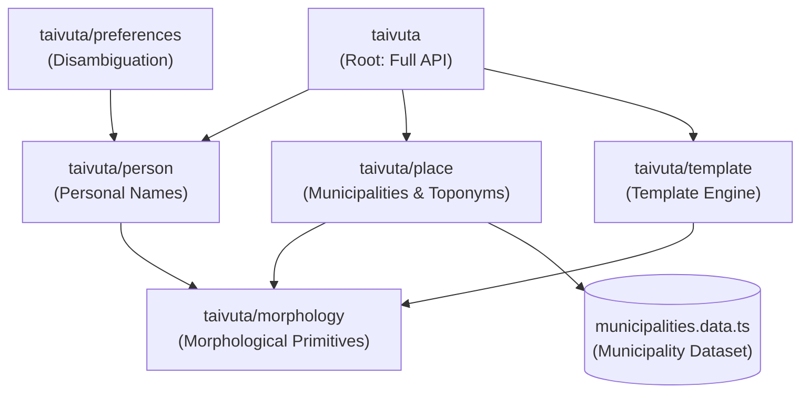

# Architecture & Design Principles

`taivuta` is a lightweight, zero-dependency TypeScript library designed for high-accuracy Finnish proper noun inflection and local case detection. This document details the core architectural patterns, morphological engine design, and module boundaries.

---

## 1. Architectural Principles

- **Zero Runtime Dependencies**: The published package has zero runtime dependencies (`dependencies: {}`). All morphological logic, vowel harmony algorithms, and datasets are self-contained.
- **Strict Module Isolation & Tree-Shaking**: Code is arranged in a Directed Acyclic Graph (DAG) with granular subpath exports. Importing one module never transitively pulls in unrelated datasets.
- **Deterministic Stem Paradigms**: Case inflection is decoupled from stem derivation via a canonical 4-tuple model (`StemParadigm`).
- **Defensive API Design**: Invalid inputs, empty strings, or unrecognized names never throw unhandled runtime exceptions; they return safe fallbacks gracefully.

---

## 2. Topological Dependency Graph & Subpaths

The codebase is organized into four decoupled subpaths under `src/`:



### Module Boundaries & Trade-offs

| Configuration / Subpath | Primary Use Case | Max Budget | What It Includes | What It Excludes |
| :--- | :--- | :--- | :--- | :--- |
| **Full `taivuta`** | General web apps, blogs, full e-commerce | < 30 kB | Auto role detection, municipalities, countries, full templates | None |
| **`taivuta/person`** | CRMs, user profiles, auth, notifications | < 12 kB | First/last names, foreign names, hyphenated names, nature surnames | Municipalities, places, countries |
| **`taivuta/place`** | Delivery, logistics, real estate, travel, maps | < 25 kB | All Finnish municipalities, countries, toponyms | Personal name heuristics, templates |
| **`taivuta/preferences`** | User onboarding, profile settings, disambiguation prompts | < 15 kB | Algorithmic ambiguity detection, multi-dimensional option generation | Municipalities, places, templates |
| **`taivuta/template`** | Chatbots, user email templates, profile UI | < 2 kB | Tagged templates `t`, `format()`, custom engine factory | Municipality dataset, personal name heuristics |
| **`taivuta/morphology`** | Custom NLP tools, search stems, grammar aids | < 12 kB | Phonology, gradation, stem analysis, paradigms, colon suffixation | High-level person/place registries |

Automated bundle budgets and zero-leak constraints are continuously verified via `scripts/verify-bundle.ts`.

---

## 3. Morphological Engine: The `StemParadigm` Model

Rather than calculating suffixes independently for all 15+ Finnish grammatical cases, `taivuta` reduces any nominal to a canonical **`StemParadigm`**:

```typescript
interface StemParadigm {
  strongVocalicStem: string;  // e.g. "Kerttu"
  weakVocalicStem: string;    // e.g. "Kertu"
  partitiveForm: string;      // e.g. "Kerttua"
  illativeForm: string;       // e.g. "Kerttuun"
  harmony: 'front' | 'back';  // e.g. "back"
}
```

### Case Dispatcher (`assembleCase`)
Every Finnish nominal case deterministically projects from this 4-tuple:
- **Strong Stem Cases**: Illative (`-Vn`), Essive (`-na/-nä`).
- **Weak Stem Cases**: Genitive (`-n`), Inessive (`-ssa/-ssä`), Elative (`-sta/-stä`), Adessive (`-lla/-llä`), Ablative (`-lta/-ltä`), Allative (`-lle`), Translative (`-ksi`), Abessive (`-tta/-ttä`).
- **Partitive**: Employs the pre-computed `partitiveForm` to account for single vs double vowel endings and consonant-stem peculiarities.

---

## 4. Consonant Gradation & Syllable Boundaries

Finnish consonant gradation (*astevaihtelu*) affects stops (*k, p, t*) in the final syllable of the inflectional stem.

To avoid false gradation in prefix syllables or compound names:
1. `splitSyllables()` decomposes the input into phonological syllables based on diphthong and vowel-consonant boundary rules.
2. `weakenConsonants()` anchors gradation strictly to the onset of the final syllable (e.g. *Kert-tu* $\to$ *Kert-u*, *Pek-ka* $\to$ *Pek-a*).
3. Surnames ending in nature words (*-koski*, *-pää*) or consonant stems (*-nen*, *-as*) apply specialized paradigm resolvers that honor Kotus nominal paradigms.

---

## 5. Toponymic Engine & Local Case Detection

In Finnish, place names require either internal local cases (*-ssa/-sta/-on*) or external local cases (*-lla/-lta/-lle*).

1. **Official Municipalities**:
   All official Finnish municipalities are classified into internal vs. external local cases based on Kotus *Asutusnimihakemisto* guidelines. Municipalities requiring external local cases (*Tampere*, *Rovaniemi*, *Vantaa*) are maintained in an optimized Set lookup table (`EXTERNAL_CASE_MUNICIPALITIES`).
2. **Toponymic Suffix Heuristics**:
   For non-municipality place names, `taivuta/place` applies linguistic suffix heuristics:
   - External: *-järvi*, *-lahti*, *-mäki*, *-niemi*, *-vesi*, *-joki*, *-harju*, *-saari*.
   - Internal: *-la/-lä*, *-kallio*, *-kangas*, *-kuru*, and generic stems.
3. **Compound Toponyms**:
   Hyphenated and spaced place names (e.g. *Uusi-Seelanti*, *Iso-Britannia*) correctly inflect only the governing head or both components according to standard Finnish grammatical conventions.

---

## 6. Name Holder Disambiguation & Preference Subsystem

In Finnish, proper nouns decline into grammatical cases, but not all Finnish names can be unambiguously inflected by grammatical algorithms alone:

1. **The Name Holder as Ultimate Authority**: Under Finnish naming conventions and linguistic guidelines (Kotus), the individual name holder is the ultimate authority on how their personal name inflects. For example, one person named *Satu* may choose standard consonant gradation (*Sadulle*), while another prefers ungradated declension (*Satulle*). Similarly, *Lucas* may be inflected using the foreign vocalic pattern (*Lucasin*) or the Finnish s-stem (*Lucaksen*).
2. **Opt-in Preference Support**: `taivuta` provides first-class support for detecting ambiguous names during user registration or onboarding, capturing the user's preferred declension, and applying it seamlessly across templates and notification strings.
3. **Safe Automated Defaults**: Consumers are **not required** to collect or track name holder preferences. When no preference is supplied, `taivuta`'s built-in heuristics automatically apply safe, idiomatic linguistic defaults that sound natural in the vast majority of scenarios.

The `taivuta/preferences` subpath provides:
- **Algorithmic Disambiguation**: Detects qualitative consonant gradation positions, nouns ending in *-s*, word-derived nominal stems, all-caps acronyms, and trailing numeral vowel harmonies without requiring exhaustive manual name dictionaries.
- **Dimension Decomposition**: Emits structured dimensions (`gradation`, `s-stem`, `vocalic-variant`, `acronym-colon`, `vowel-harmony`) with precomputed example inflections.
- **Cartesian Option Bundling**: Automatically computes combination options for multi-dimensional cases (e.g. `SATU` combining acronym vs. word and gradation vs. no-gradation).
- **Default Linguistic Fallbacks**: Resolves recommended linguistic defaults when no explicit preference is provided.
